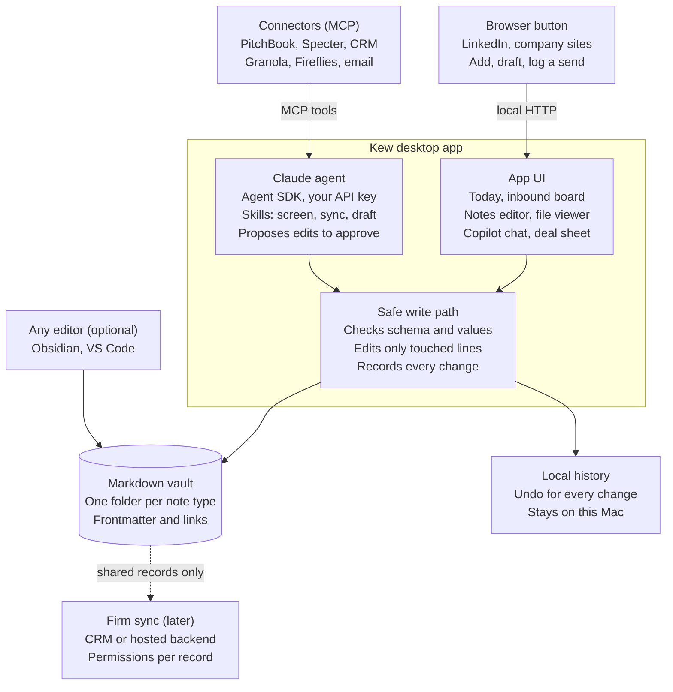
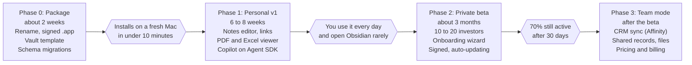
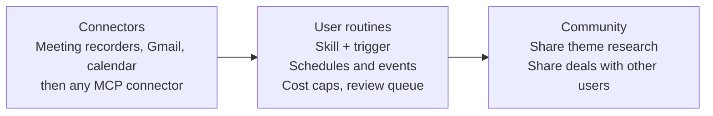

# Kew — Product Spec

_Last updated 2026-11-24 · Owner: Derek Wu_

Kew is a desktop app that gives a VC associate or partner a whole deal workflow in one place: sourcing, outreach, triage, diligence, and a memory of every company and person. It sits on a markdown vault the investor owns, and Claude does the legwork. The name is a nod to Q, the quartermaster who equips Bond before every mission.

## Problem and users

An investor's working day is spread across a CRM nobody updates, LinkedIn, email, a notes app, meeting recorders, data tools like PitchBook, and a folder of decks. Nothing connects them, so follow-ups slip, context is rebuilt before every call, and the firm's memory lives in people's heads.

Kew puts that whole loop in one app. It is opinionated: it ships with a VC workflow already set up, not a blank database to configure. Every field and template can still be changed.

| User | Main jobs | What they need most |
| --- | --- | --- |
| Associate or principal | Source companies, run outreach, screen inbound, write first-pass diligence, keep market maps | Speed: capture in one click, never miss a follow-up, a first screen in minutes |
| Partner | Take meetings, decide, write memos, keep founder and co-investor relationships warm | Context: a one-page brief before every call, a pipeline they can trust |
| Solo GP or scout (later) | Everything above with no team or ops support | A complete system with no setup |

The v1 user is one investor working alone in their own vault, on one desktop. No mobile app, no multi-device sync and no cloud backup in v1: nothing leaves the machine except calls to Claude. Team features come after the single-player product is good enough that people use it every day.

Wireframes: [`design/wireframes/`](design/wireframes/README.md), live on the [design canvas](https://claude.ai/artifact/6tkZR7eAVQicvsRxGwEESW).

## Product principles

1. **You own the data.** Everything is plain markdown files in a folder on the user's machine. Kew stores nothing in the cloud; backup is the user's own (Time Machine, or a synced folder). No lock-in: Obsidian, any editor, or Claude can read the same files.
2. **Claude does the legwork, the investor decides.** Claude drafts, enriches, screens and summarizes. New notes it writes apply right away and can be undone; changes to existing fields, status changes, passes and outbound messages need a click from the investor.
3. **Capture where the work happens.** A browser button on LinkedIn, company sites and data tools, and a transcript dropped in becomes a meeting note. Nobody retypes anything.
4. **Opinionated defaults, yours to change.** Kew ships starter fields, templates, vocabularies, skills and views for a VC workflow. Users can edit or extend them; only the few fields the app depends on are fixed.
5. **Every write is safe and visible.** Edits change only the lines they touch, and every change is recorded in a local history that can be undone.

## Features

V1 covers capture, outreach, triage, notes and the copilot. Those are the daily habits. Deep diligence and team features build on them.

| Module | V1 | Later |
| --- | --- | --- |
| Today | Follow-ups due, replies owed, unsent drafts, new inbound, companies to reach out to on a set date | A morning brief: today's meetings with a one-page prep for each |
| Browser button | On LinkedIn profiles, LinkedIn company pages and company sites: add a person or company, draft a message, log a send or reply. Duplicate check with "did you mean" | Capture from PitchBook, Crunchbase and X; save a deck link from DocSend |
| Outreach | Each contact's log, cadence and next nudge. Claude drafts in the investor's voice. Unmet contacts get a person note marked not met | Email send and reply detection (Gmail, Outlook); sequences |
| Inbound board | A view of companies by pipeline status: new, pursuing, reached out, no reply, passed. Reach-out dates, editing and enrichment | Scoring and ranking by thesis fit |
| Notes | Markdown editor with live preview, `[[links]]`, backlinks, a properties panel, search. Editable templates and fields. Viewer for PDF and Excel; Quick Look for PowerPoint and Word | Graph view, embedded queries, custom note types |
| Copilot | A side panel for quick questions and edits on the open note. A full-screen diligence workspace whose output is notes: research notes and themes, linked to the company, with sources cited | Routines: skills that run on a schedule or event (see Future roadmap) |
| Meetings | Drop in or paste a transcript; Claude writes the meeting note and updates the company and person notes | Sync from a recorder (Granola, Fireflies) through connectors; pre-meeting briefs; action items as follow-ups |
| Diligence | A tabbed workspace per company (overview, team, market and competition, financials, product, references, files). Each tab shows what's already known from notes and attachments, with sources, conflicts and gaps; chat beside it does more homework. A files tab reads data room PDFs, decks and spreadsheets. One-click screen fills the tabs | TAM, comps, memo drafts; importing a data room from a link |
| Themes | One note per theme holding its landscape and thesis; lists its companies | Market maps; thesis tracking |
| Deal sheet | Queue companies, group by live deals and market intel, compile and share | Templates per firm |
| Dashboards | Pipeline, companies and deal sheet views inside the app | Custom views |

## Data model

Four primitives hold everything: companies, people, meetings and themes. Research notes and attachments hang off them. Each record is a markdown note with YAML frontmatter, one folder per type, and a stable `id` that never changes, so links survive renames.

| Primitive | Folder | Starter fields | Links to |
| --- | --- | --- | --- |
| Company | `Companies/` | name, aliases, website, pipeline status, stage, themes, round status, raise, valuation, lead, referred by, first seen, reach out on, conviction, pass reason, deal sheet | People, themes |
| Person | `People/` | name, role, company, met, category, LinkedIn, email, channel, cadence, last outbound, last inbound, next follow-up; an append-only outreach log in the body | Company |
| Meeting | `Meetings/` | date, company, attendees, source recorder, transcript | Company, people |
| Theme | `Themes/` | slug, name, living topic; landscape, thesis and signal log sections in the body | Companies (from a query) |
| Research | `Research/` | about (any records), kind (note or screen), topic (team, market, financials, product, references; the diligence tab it feeds), sources, created | Any record |
| Attachment | `Attachments/<record id>/` | Plain files (decks, models, transcripts), no note | One record |

Three rules keep the vault clean:

- **One company, one note, forever.** Inbound, pursuing, active and passed are values of the pipeline status, not folders. Files never move; the inbound board and the passed list are views.
- **Everyone you deal with gets a Person note.** Unmet contacts carry `met: false` and are hidden from the default People view. Outreach always lives on the person, so nothing is copied between notes after a first meeting.
- **Derived state is computed, not stored.** Last touch, replies owed and follow-ups due come from the outreach log and dates, in the app's index.

### Fields and templates are the user's to change

Kew ships starter templates and fields for a VC workflow, and every user can change them. The schema lives in the vault (`.kew/schema.yaml`), not in the app, so it travels with the notes and its changes are in the history. Fields come in three tiers:

| Tier | Examples | What the user can do |
| --- | --- | --- |
| System | id, type, name, pipeline status, met, outreach dates, about | Relabel, add or rename options. Can't delete: Today, the board and outreach depend on them |
| Starter | stage, sector, conviction, round fields, deal sheet | Edit, rename, change options or delete |
| Custom | Anything the user adds | Full control. Types: text, number, date, select, multi-select, relation, URL, checkbox |

- **Pipeline stages map to fixed categories.** Users can rename stages or add their own, but each one maps to a built-in category (new, in progress, active, closed). That lets Today and the board keep working whatever the stages are called.
- **Templates are markdown files** in `Templates/`, one per primitive, holding the default body sections. Users edit them in the app or any editor.
- **Schema changes migrate the vault.** Renaming a field or an option rewrites every affected note through the safe write path as one change, which can be undone.
- **Unknown fields are kept.** A field added by hand or by another tool is preserved and shown as untyped until the user adds it to the schema.
- **Custom note types come later.** V1 is limited to the four primitives plus research.

## The AI layer

Claude runs as an agent inside the vault. It reads notes and uses skills that ship with the app; data connectors come later. It writes only through the app's safe edit path, so every change follows the schema and lands in the history.

- **Notes are the output, the chat is scratch.** Anything worth keeping from a conversation ends up in the vault. "Research Quill's market" finds or proposes the theme, writes a research note with `about:` links to the company and theme, and the note shows on both pages. Before creating a theme or research note, Claude checks for an existing one, the same duplicate check as companies.
- **Two sizes of copilot.** A side panel beside the open note for quick questions and small edits. A full-screen diligence workspace for longer work: the conversation on one side, the notes being written on the other, with a visible plan and progress. Long tasks keep running while the investor does other things.
- **Approval matches risk.** New notes apply right away and can be undone. Changes to existing fields, status and outreach show as a diff to approve.
- **Every claim cites its source:** a note, a URL or a meeting. Each research note links back to the session that wrote it, so the investor can pick it up again.
- **Skills:** packaged routines such as screen a company, research a market, compile the deal sheet, write up a meeting, check vault hygiene, and draft a pass note. Each runs as a button or a chat command.
- **Connectors (later):** the user's own subscriptions (PitchBook, Specter, Affinity, Granola, email, calendar) through MCP. Kew never holds the user's data-vendor credentials.
- **Voice:** a style profile learned from the investor's sent messages, used for every draft.

**Licensing is the decision that most shapes the business.** Anthropic's Agent SDK docs say: "Unless previously approved, Anthropic does not allow third party developers to offer claude.ai login or rate limits for their products, including agents built on the Claude Agent SDK" ([source](https://code.claude.com/docs/en/agent-sdk/overview)). So a commercial Kew cannot run on users' Claude subscriptions by default. The options:

| Option | How it works | Trade-off |
| --- | --- | --- |
| Bring your own API key | The user pastes an Anthropic API key; the app uses the Agent SDK | Allowed today. The user pays per use, so cost must be shown in the app |
| Hosted, priced into the plan | Kew holds the API account and charges a subscription | Simplest for users; usage cost becomes the margin risk |
| Subscription login | Uses the user's own Claude plan | Needs Anthropic's approval; ask early |

Recommendation: build on the Agent SDK with bring-your-own key for the beta, and ask Anthropic about a partnership in parallel. The current prototype (Brain Desk), which runs the user's own Claude Code, is fine for personal use but not for a product.

## Team mode

Each investor keeps a personal vault, and the firm gets a shared layer on top. A shared git repo can't do this: it has no permissions, no private notes, and edits made at the same time conflict.

- **Shared:** companies, pipeline status, deal sheet entries, meeting summaries the author marks as shared, and files (decks, models).
- **Private:** drafts, personal notes, outreach to people the firm doesn't need to see.
- **How it syncs:** two-way sync with the firm's CRM (Affinity first) if it has one. Otherwise, a hosted Kew backend with per-record permissions and live updates. The personal vault stays the working copy in both cases.
- **Files:** stored in the firm's drive (SharePoint or Google Drive) and linked from notes, instead of in each personal vault.

Design v1's data model so a record can later be marked shared without a migration: give every note a stable ID and a visibility field from day one.

## Architecture

The app and Claude write through one safe path into a vault you own.

The browser button, the UI and the Claude agent never write files directly. They all go through one write path that checks the schema and records the change, so the vault stays clean whoever made the change. Edits from other editors are checked by a hook.

The history is a git repository kept outside the vault (in the app's support folder, pointed at the vault), so the vault folder stays clean and is safe to keep in iCloud or Dropbox. It has no remote: nothing is pushed anywhere. The user never sees git; they see a history list and an undo button.

## Roadmap

Ship it for yourself first, then to 20 beta investors, then to firms. A phase starts only when the gate before it is met.

Durations are estimates for one builder working with Claude. The gates matter more than the dates: don't start the beta until you'd rather use Kew than Obsidian yourself.

### Future roadmap

After the personal product works, three expansions build on each other: data comes in by itself, then Claude works on a schedule, then investors share with each other.

| Stage | What it adds | What it needs first |
| --- | --- | --- |
| Connectors | Meeting notes, email replies and calendar events arrive without manual entry. Unlocks reply detection, the voice profile and pre-meeting briefs | MCP support in the agent; the user's own credentials, never held by Kew |
| User routines | A routine is a skill plus a trigger: a button, a chat command, a schedule ("weekdays at 7am") or an event ("a meeting synced"). Built-in ones first (meeting sync, morning brief, follow-up drafts), then routines users build | A background process that runs at login and catches up on launch; a cost cap per routine; a review queue on Today, because routines read untrusted text (email, transcripts) and must not write fields directly |
| Community | Investors share their view on a research theme and share deals with other Kew users, like a deal sheet sent inside the app | A hosted service, the same one team mode and multi-device sync need; per-record sharing; consent and confidentiality rules for deal data |

Community and team mode share most of their infrastructure. Which comes first is an open question.

## Success metrics, risks and open questions

**Metrics for the beta (10–20 investors):**

- 4 or more days a week of use per investor after 30 days
- More than 80% of outreach logged through the app or the button, not by hand
- Follow-ups sent on time: more than 90% of nudges done by their due date
- Time from finding a company to its first screen: under 10 minutes
- 30-day retention of 70% or more

**Risks:**

| Risk | Mitigation |
| --- | --- |
| Claude cost per user is high if agents run often | Show usage in the app; cache; use a smaller model for routine enrichment |
| LinkedIn changes its page structure and breaks the button | Keep scraping tolerant, with fallbacks; manual entry always works |
| Data vendors restrict use of their data by AI agents | Use only the user's own connectors; never store vendor data beyond notes |
| Firms won't let confidential deal data leave their machines | Local-first by design; model provider choice and data retention terms documented |
| Investors already have a CRM and won't switch | Sync with the CRM instead of replacing it |

**Open questions:**

- [ ] Pricing: per seat, per firm, or bring-your-own key with a cheaper seat?
- [ ] Anthropic partnership for subscription login: worth asking now?
- [ ] Is Obsidian compatibility a feature to market, or just a safety net?
- [ ] Which recorder and CRM integrations first, based on what beta users already run?
- [ ] Windows support in v1, or Mac only?
- [ ] Community or team mode first? Both need the same hosted sharing layer.
- [ ] Multi-device and mobile sync: git, file sync (iCloud, Dropbox), or a hosted sync service that doubles as the team backend? Deferred until after v1.
- [ ] Name: check trademarks and domains for "Kew" (Kew Gardens is a well-known UK brand; Kew Capital is a London macro advisory firm).
