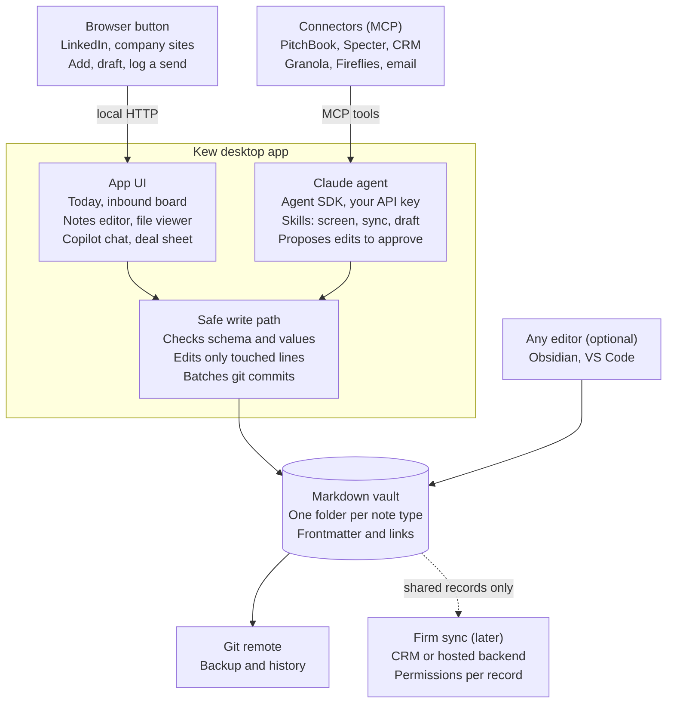
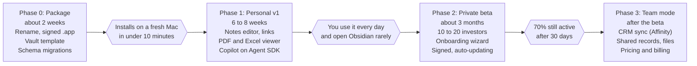

# Kew — Product Spec

_Last updated 2026-11-23 · Owner: Derek Wu_

Kew is a desktop app that gives a VC associate or partner a whole deal workflow in one place: sourcing, outreach, triage, diligence, and a memory of every company and person. It sits on a markdown vault the investor owns, and Claude does the legwork. The name is a nod to Q, the quartermaster who equips Bond before every mission.

## Problem and users

An investor's working day is spread across a CRM nobody updates, LinkedIn, email, a notes app, meeting recorders, data tools like PitchBook, and a folder of decks. Nothing connects them, so follow-ups slip, context is rebuilt before every call, and the firm's memory lives in people's heads.

Kew puts that whole loop in one app. It is opinionated: it ships with a VC workflow already set up, not a blank database to configure.

| User | Main jobs | What they need most |
| --- | --- | --- |
| Associate or principal | Source companies, run outreach, screen inbound, write first-pass diligence, keep market maps | Speed: capture in one click, never miss a follow-up, a first screen in minutes |
| Partner | Take meetings, decide, write memos, keep founder and co-investor relationships warm | Context: a one-page brief before every call, a pipeline they can trust |
| Solo GP or scout (later) | Everything above with no team or ops support | A complete system with no setup |

The v1 user is one investor working alone in their own vault. Team features come after the single-player product is good enough that people use it every day.

## Product principles

1. **You own the data.** Everything is plain markdown files in a folder on the user's machine, synced with git. No lock-in: Obsidian, any editor, or Claude can read the same files.
2. **Claude does the legwork, the investor decides.** Claude drafts, enriches, screens and summarizes. Status changes, passes and outbound messages need a click from the investor.
3. **Capture where the work happens.** A browser button on LinkedIn, company sites and data tools. Meeting notes sync in on their own. Nobody retypes anything.
4. **Conventions ship with the app.** The schema, controlled vocabularies, skills and dashboards are versioned with the app. An app update can migrate the vault.
5. **Every write is safe and visible.** Edits change only the lines they touch, and every change is a readable git commit that can be undone.

## Features

V1 covers capture, outreach, triage, notes and the copilot. Those are the daily habits. Deep diligence and team features build on them.

| Module | V1 | Later |
| --- | --- | --- |
| Today | Follow-ups due, replies owed, unsent drafts, new inbound, companies to reach out to on a set date | A morning brief: today's meetings with a one-page prep for each |
| Browser button | On LinkedIn profiles, LinkedIn company pages and company sites: add a person or company, draft a message, log a send or reply. Duplicate check with "did you mean" | Capture from PitchBook, Crunchbase and X; save a deck link from DocSend |
| Outreach | Each contact's log, cadence and next nudge. Claude drafts in the investor's voice. People pages only for people they've met | Email send and reply detection (Gmail, Outlook); sequences |
| Inbound board | New, Pursuing, Reached out, No reply, Passed. Passed notes move to a graveyard folder. Reach-out dates, editing and enrichment | Scoring and ranking by thesis fit |
| Notes | Markdown editor with live preview, `[[links]]`, backlinks, a properties panel, search. Viewer for PDF and Excel; Quick Look for PowerPoint and Word | Graph view, templates, embedded queries |
| Copilot | Chat with Claude that sees the open note and the vault. Can draft, look things up and propose edits, which the investor approves | Background agents that run on a schedule |
| Meetings | Sync notes from a recorder (Granola, Fireflies) into company, person and meeting notes | Pre-meeting briefs; action items as follow-ups |
| Diligence | One-click screen: team, product, market and a skeptical review, written to the company note | Data room review, TAM, comps, memo drafts |
| Markets and theses | Themes as a controlled vocabulary; a market page lists its companies | Market maps; thesis tracking |
| Deal sheet | Queue companies, group by live deals and market intel, compile and share | Templates per firm |
| Dashboards | Pipeline, companies and deal sheet views inside the app | Custom views |

## Data model

Each record is a markdown note with YAML frontmatter, one folder per type. The app enforces controlled values (status, stage, themes) on every write, and a hook checks edits made outside the app.

| Note type | Folder | Key fields |
| --- | --- | --- |
| Inbound company | `Inbound/` (passed: `Inbound/Passed/`) | status, source, referred by, first seen, reach out on, deal sheet, round status, raise, themes, contact fields for unmet founders |
| Company | `Companies/` | stage, sector, status, round, lead, valuation, last touch, themes, deal sheet |
| Person | `People/` (only people the investor has met) | role, company, category, LinkedIn, email, cadence, last outbound, last inbound, next follow-up |
| Meeting | `Meetings/` | date, attendees, company, source recorder, summary, action items |
| Market or theme | `Markets/` | theme key, thesis, companies (from a query) |
| Deal sheet | `Deal Sheets/` | date, companies included, recipients |

Two rules keep the vault clean. Outreach to someone the investor hasn't met lives on the company's note, or on a "Name (Stealth)" note, until they meet. Moving a company to Passed moves its file, not just its status.

## The AI layer

Claude runs as an agent inside the vault. It reads notes, uses skills that ship with the app, and calls the user's data connectors. It writes only through the app's safe edit path, so every change follows the schema and becomes a commit.

- **Copilot:** a chat pane beside the open note, with streaming answers and resumable sessions. Proposed edits show as a diff to approve.
- **Skills:** packaged routines such as screen a company, compile the deal sheet, sync meetings, check vault hygiene, and draft a pass note. Each runs as a button or a chat command.
- **Connectors:** the user's own subscriptions (PitchBook, Specter, Affinity, Granola, email, calendar) through MCP. Kew never holds the user's data-vendor credentials.
- **Voice:** a style profile learned from the investor's sent messages, used for every draft.

**Licensing is the decision that most shapes the business.** Anthropic's Agent SDK docs say: "Unless previously approved, Anthropic does not allow third party developers to offer claude.ai login or rate limits for their products, including agents built on the Claude Agent SDK" ([source](https://code.claude.com/docs/en/agent-sdk/overview)). So a commercial Kew cannot run on users' Claude subscriptions by default. The options:

| Option | How it works | Trade-off |
| --- | --- | --- |
| Bring your own API key | The user pastes an Anthropic API key; the app uses the Agent SDK | Allowed today. The user pays per use, so cost must be shown in the app |
| Hosted, priced into the plan | Kew holds the API account and charges a subscription | Simplest for users; usage cost becomes the margin risk |
| Subscription login | Uses the user's own Claude plan | Needs Anthropic's approval; ask early |

Recommendation: build on the Agent SDK with bring-your-own key for the beta, and ask Anthropic about a partnership in parallel. The current prototype (Brain Desk), which runs the user's own Claude Code, is fine for personal use but not for a product.

## Team mode

Each investor keeps a personal vault, and the firm gets a shared layer on top. A shared git repo can't do this: it has no permissions, no private notes, and edits made at the same time conflict.

- **Shared:** companies, pipeline status, deal sheet entries, meeting summaries the author marks as shared, and files (decks, models).
- **Private:** drafts, personal notes, outreach to people the firm doesn't need to see.
- **How it syncs:** two-way sync with the firm's CRM (Affinity first) if it has one. Otherwise, a hosted Kew backend with per-record permissions and live updates. The personal vault stays the working copy in both cases.
- **Files:** stored in the firm's drive (SharePoint or Google Drive) and linked from notes, instead of in git.

Design v1's data model so a record can later be marked shared without a migration: give every note a stable ID and a visibility field from day one.

## Architecture

The app and Claude write through one safe path into a vault you own.

The browser button, the UI and the Claude agent never write files directly. They all go through one write path that checks the schema and commits, so the vault stays clean whoever made the change. Edits from other editors are checked by a hook.

## Roadmap

Ship it for yourself first, then to 20 beta investors, then to firms. A phase starts only when the gate before it is met.

Durations are estimates for one builder working with Claude. The gates matter more than the dates: don't start the beta until you'd rather use Kew than Obsidian yourself.

## Success metrics, risks and open questions

**Metrics for the beta (10–20 investors):**

- 4 or more days a week of use per investor after 30 days
- More than 80% of outreach logged through the app or the button, not by hand
- Follow-ups sent on time: more than 90% of nudges done by their due date
- Time from finding a company to its first screen: under 10 minutes
- 30-day retention of 70% or more

**Risks:**

| Risk | Mitigation |
| --- | --- |
| Claude cost per user is high if agents run often | Show usage in the app; cache; use a smaller model for routine enrichment |
| LinkedIn changes its page structure and breaks the button | Keep scraping tolerant, with fallbacks; manual entry always works |
| Data vendors restrict use of their data by AI agents | Use only the user's own connectors; never store vendor data beyond notes |
| Firms won't let confidential deal data leave their machines | Local-first by design; model provider choice and data retention terms documented |
| Investors already have a CRM and won't switch | Sync with the CRM instead of replacing it |

**Open questions:**

- [ ] Pricing: per seat, per firm, or bring-your-own key with a cheaper seat?
- [ ] Anthropic partnership for subscription login: worth asking now?
- [ ] Is Obsidian compatibility a feature to market, or just a safety net?
- [ ] Which recorder and CRM integrations first, based on what beta users already run?
- [ ] Windows support in v1, or Mac only?
- [ ] Name: check trademarks and domains for "Kew" (Kew Gardens is a well-known UK brand; Kew Capital is a London macro advisory firm).
