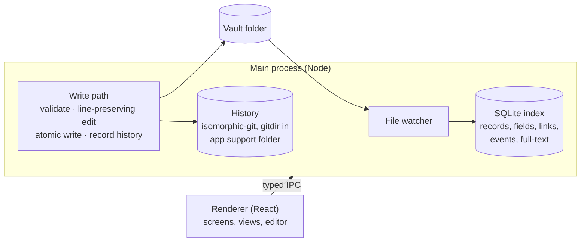

# Kew core loop — design

_2026-11-24 · First build slice of the Kew desktop app. Product context: `SPEC.md`. Screens: `design/wireframes/`._

## Intent

Build the first real version of Kew: a local Mac app that a VC investor can download, open, and run their deal flow in. This slice covers the core loop: capture a company, triage it on the pipeline, track outreach to people, and get nudged on Today. It runs on a markdown vault the user owns.

It must work for anyone Derek hands it to, not just on his machine. It must also look and feel sharp: clean, fast, pleasant to use every day. The bar is "I'd rather use this than Obsidian plus a spreadsheet."

## Goals

1. A packaged Mac app (`.dmg`) that installs and runs on a fresh Mac with nothing else installed, after a one-time "Open Anyway" approval.
2. First launch creates a sample vault so the app is useful in the first minute; the user can also pick an existing folder.
3. The core loop works end to end on that vault: Today, Pipeline, Company records, Person records with outreach, plus basic Meetings, Themes and Research records.
4. The data foundation is the real one, built to last: files as truth, a rebuildable SQLite index, one safe write path, a local undo history, and a user-editable schema.
5. A visual design that feels deliberate and polished, not a default component library.

## Non-goals (this slice)

- Claude in any form: copilot, drafting, diligence workspace, screens, API key setup. They come next, on top of this slice's write path.
- The browser button (Chrome extension and local server).
- Connectors, routines, meeting-recorder sync.
- Migrating Derek's existing vault. A migration tool may come later.
- Sync, cloud backup, accounts, team features, mobile.
- Windows and Linux builds.
- Code signing and auto-update (the packaging is set up so they can be switched on at beta time).

## Anti-goals

- **Lock-in.** If the vault can't be opened and understood in Obsidian or any text editor, the slice has failed.
- **Data loss or noisy rewrites.** An edit that reformats lines it didn't change, drops unknown fields, or loses a user's hand edit is a failure even if the feature works.
- **Depending on the user's machine.** No reliance on `git`, Node, Claude Code or anything else being installed.
- **A generic look.** Default shadcn/Bootstrap styling with no point of view is a failure of goal 5.

## Constraints

- macOS only, Apple Silicon and Intel. _(Builder's note: Mac-only is Claude's call, based on the target users; it settles the spec's open Windows question for v1.)_
- Electron + TypeScript + React, decided below.
- The vault must stay Obsidian-compatible: plain markdown, YAML frontmatter, `[[wikilinks]]` by note title.
- Nothing leaves the machine. No network calls at all in this slice.
- Undo history must not put a `.git` folder inside the vault (vaults are often kept in iCloud or Dropbox, which corrupt `.git`).
- Code lives in this repo under `app/` (the spec stays at the root).

## Approaches considered

| Approach | Trade-off | Outcome |
| --- | --- | --- |
| **A. Electron + TypeScript + React** | Larger download (~150 MB). Same shell as the Brain Desk prototype, so its extension server carries over later; the Claude Agent SDK is TypeScript-first; types keep a growing codebase manageable | **Picked** |
| B. Tauri (Rust core, web UI) | Small and fast, but the Claude SDK would need a Node sidecar and the write path would be written in Rust. More moving parts for one builder | Rejected |
| C. Extend Brain Desk in plain JS | Fastest first week, but untyped, no components, and built on the old data model | Rejected |

## Reuse from the prototype

From `github.com/DerekJongWu/brain-desk`, port to TypeScript rather than rewrite:

- `lib/note.js`: line-preserving frontmatter and section editing (`setKeys`, `appendToSection`, the YAML quoting rule).
- `lib/vault.js`: duplicate-matching helpers (`bareDomain`, `normName`, `linkedinSlug`), the outreach log line format and the "who owes whom" rule.
- Its test cases, as fixtures for the new data core.

Everything else (vault model, git push, Claude CLI calls, renderer) is replaced.

## The vault

### Layout

```
<vault>/
  Companies/   People/   Meetings/   Themes/   Research/
  Attachments/<record id>/...
  Templates/   Company.md  Person.md  Meeting.md  Theme.md  Research.md
  .kew/schema.yaml
```

The user's other files and folders are left alone and ignored by the index.

### Note format

Every record is `<Folder>/<Title>.md` with YAML frontmatter:

```markdown
---
id: 01JD3K8N4R2V6T0X9Y1Z2A3B4C
type: company
name: Quill Security
pipeline_status: reached-out
stage: seed
themes: ["[[AI Agent Security]]"]
website: quill.example
first_seen: 2026-11-12
---

## What it is
...
```

- `id` is a ULID written on create and never changed. Notes without one (added by hand) get one the first time the app writes to them, not on read.
- `type` is the note type. Folder and type should agree; if they don't, `type` wins and the note is flagged.
- Relations are stored Obsidian-style as wikilink strings (`"[[Title]]"`), so Obsidian shows them as links. The index resolves them to IDs by title and `aliases`. Renaming a record in Kew renames the file and rewrites every link to it, as one undoable change.
- Values follow the prototype's quoting rule. Unknown keys are preserved exactly.

### Outreach log and derived state

People notes keep the prototype's append-only `## Outreach log`, one line per touch:

```
- 2026-11-21, out · linkedin: Intro note, Sam suggested we talk
- 2026-11-24, in · email: Shared round details
```

The index parses these into events. `last_outbound`, `last_inbound`, "replies owed" and "follow-up due" are computed from the events and the person's `cadence_days`, not stored. Two fields stay stored because the user sets them: `cadence_days` and an optional `next_follow_up` override. _(This refines the prototype, which stored the dates. Deriving them avoids stale data; the app may write them back later for Obsidian users.)_

### Schema (`.kew/schema.yaml`)

The user-editable definition of note types, fields and options, as described in `SPEC.md` › Data model. Shape:

```yaml
version: 1
types:
  company:
    folder: Companies
    template: Templates/Company.md
    fields:
      - key: pipeline_status
        label: Pipeline status
        type: stage            # select whose options map to fixed categories
        tier: system
        options:
          - { value: new, label: New, category: new }
          - { value: pursuing, label: Pursuing, category: in-progress }
          - { value: reached-out, label: Reached out, category: in-progress }
          - { value: no-reply, label: No reply, category: in-progress }
          - { value: active, label: Active, category: active }
          - { value: revisit, label: Revisit, category: closed }
          - { value: passed, label: Passed, category: closed }
          - { value: archived, label: Archived, category: closed }
      - { key: stage, label: Stage, type: select, tier: starter, options: [...] }
      - { key: themes, label: Themes, type: relation, target: theme, multiple: true, tier: starter }
      ...
```

- Field types: `text`, `number`, `date`, `select`, `multi-select`, `stage`, `relation`, `url`, `checkbox`.
- Tiers: `system` (can relabel and edit options, can't delete), `starter`, `custom`.
- The app ships a default schema and default templates and writes them into a new vault. App updates that change system fields migrate the schema file with a version bump.
- Schema edits made in Settings that rename a field key or an option value rewrite every affected note through the write path, as one undoable change.
- The schema file is validated on load. If it's invalid (bad hand edit), the app shows the error and falls back to the last valid copy, without overwriting the user's file.

### File names and titles

_(Claude's call.)_

- Companies, People, Themes and Research use their `name` as the file name and link text. Research gets a `name` field (system).
- Meetings are named `YYYY-MM-DD <Company or first attendee> <meeting type>`, for example `2026-11-18 Quill Security intro`. The `name` field holds the same text.
- **Clashes:** a new record whose name matches an existing record of any type gets a suffix: people get ` (<Company>)`, others get ` (<type>)`. Duplicate checking runs first, so a clash is offered as "Did you mean …?" before the suffix is applied.
- Names are sanitized for the file system using the prototype's `safeFilename`; the frontmatter `name` keeps the original.

### Default fields

| Type | System fields | Starter fields |
| --- | --- | --- |
| Company | id, type, name, aliases, website, pipeline_status | source (select: intro, email, event, LinkedIn, inbound form, other), stage, themes, round_status, raise, valuation, lead, referred_by (relation → person), first_seen, reach_out_on, conviction, pass_reason, deal_sheet |
| Person | id, type, name, met, company (relation), linkedin, email | role, category, channel, cadence_days, next_follow_up |
| Meeting | id, type, date, company (relation), attendees (relation → people) | meeting_type, transcript (attachment link) |
| Theme | id, type, name, slug | living_topic |
| Research | id, type, name, about (relation, any type, multiple), topic, created | kind, sources |

## Architecture



- **The renderer never touches the file system.** It calls a typed API exposed by the preload script (`queries` and `commands`). Context isolation on, node integration off.
- **Index:** SQLite (`better-sqlite3`), stored in the app support folder, keyed by vault path. Tables for records, field values, links (resolved and unresolved), outreach events, and an FTS5 table for search. It's rebuilt from scratch on demand and incrementally from the file watcher. Deleting it is always safe.
- **Write path:** the only code that writes to the vault. Every command (set fields, append log line, create record, rename, schema change) validates against the schema, applies line-preserving edits, writes atomically (temp file + rename), and records one history entry. If the file changed on disk since it was read, the command re-reads and re-applies, or fails clearly. It never overwrites a hand edit.
- **History:** `isomorphic-git` (pure JS, no system git), with the git directory in the app support folder and the vault as the work tree. One commit per user action, with a readable message ("Moved Quill Security to Reached out").
  - **Before every app write**, any uncommitted changes to the files it touches are committed first as an "External edits" entry. So a hand edit is always in history before the app changes the same file.
  - **Undo reverses one action's changes, not whole files.** It applies the reverse of that action's diff. If any of its files changed since (by hand or by a later action), undo is refused with a clear message, and the history list shows that entry as no longer undoable. _(Claude's call.)_
  - **Any entry in the history list can be undone** if its files are unchanged since. Undo is itself recorded as an entry ("Undid: Moved Quill Security to Reached out"), so undoing an undo is redo. No separate redo stack. _(Claude's call.)_
  - Attachments are not versioned in history in this slice (there are none yet; see Attachments).
- **Outside edits:** the watcher re-indexes changed files. Notes that break the schema (bad value, invalid YAML) are flagged in the UI with the problem, never silently fixed.
- **Settings and state:** app-level settings (current vault path, window state) live in the app support folder, not the vault.

## Screens in this slice

Layouts follow the wireframes. The look comes from the visual design pass (below), not the wireframes.

| Screen | Must do |
| --- | --- |
| First launch | Welcome with the three paths under Sample vault (try the sample, start my vault, open a folder). An existing folder that isn't a Kew vault gets the schema and templates added, with a confirmation that lists what will be created |
| Shell | Sidebar (Today, Pipeline, Companies, People, Meetings, Themes, Research, Settings), ⌘K command bar (jump to any record, run commands like "New company"), history/undo control, a status line showing save state |
| Today | Follow-ups due, replies owed, reach out today, new inbound. Actions in this slice: log a send, log a reply, snooze, pursue, pass, push the reach-out date. ("Draft" buttons are absent until Claude lands) |
| Pipeline | Board grouped by pipeline status with drag and drop between columns, and a table view. Saved views as tabs (Inbound, Active deals, Passed, All). Filter by theme and by any select field |
| Companies, People, Meetings, Themes, Research | A table view per type with sorting, filtering and column choice. "New" creates a record from its template |
| Record page | Properties panel (all schema fields, inline editing by field type, "+ Add a property" creates a custom field), the markdown body in an editor, backlinks ("Mentioned in"), and an activity timeline. Company: pass flow with reason. Person: outreach card with state, log send/reply, cadence, the outreach log, "We met" |
| Editor | CodeMirror 6 markdown editing with `[[` autocomplete for records, clickable links, and readable rendering of headings and lists. Full Obsidian-style live preview is not required |
| Settings › Fields | Per type: list fields, add, rename, change type where safe, edit options, map stages to categories, delete non-system fields (with a count of notes affected) |
| Settings › Vault and history | Vault location, switch vault, rebuild index, history list with undo |
| Search | ⌘K searches titles and aliases; a full search view searches note bodies |

## Workflow rules

These carry over the prototype's behavior, adapted to the new model. _(Claude's call, based on how Brain Desk works today.)_

- **Logging the first send to a person** moves their company from `new` or `pursuing` to `reached-out`. Both files change as one undoable action.
- **"We met"** sets `met: true` on the person and, if their company's status category is `new` or `in-progress`, moves the company to `active`. One action.
- **`no-reply`** is only ever set by hand. The app never moves a company on a timer.
- **Passing a company** (status category `closed`) stops follow-up nudges for its people who haven't been met. Met people keep their own cadence.
- **"Pursue" on Today** only sets `pipeline_status: pursuing`.
- Pipeline cards show the latest outreach event for the company's people ("Messaged 3 days ago"), read from the index.

### Follow-up and reply rules

For each person with outreach events (or a company's people), computed in the index. _(Claude's call.)_

- **Reply owed** (on Today as "Replies you owe"): the latest event is `in`. It clears when an `out` is logged after it.
- **Follow-up due:** the latest event is `out` and `cadence_days` is set; due on the date of that `out` plus `cadence_days`. An `in` after it switches the person to "reply owed" instead.
- **Keep in touch:** a person with `met: true` and `cadence_days` set, whose latest event of any kind is older than `cadence_days`, is due too ("Met 30 days ago, cadence 30 days").
- **No `cadence_days`** means no nudges for that person.
- **`next_follow_up` overrides** the computed date, earlier or later. It's cleared when the next event is logged.
- **Snooze** writes `next_follow_up` (presets: 3 days, 1 week, 2 weeks, pick a date). It works for "reply owed" items too: they're hidden until that date.

## Duplicate checking

Creating a company checks name (normalized), aliases and website domain across all companies; creating a person checks name and LinkedIn slug. A likely match shows "Did you mean …?" with the option to open it or create anyway. Port the prototype's normalizers.

## Sample vault

The sample vault is a demo, separate from the user's real vault. _(Claude's call.)_ First launch offers three paths:

- **Try the sample vault:** created at `~/Documents/Kew Sample`, clearly labeled "Sample" in the sidebar.
- **Start my vault:** an empty vault at `~/Documents/Kew` (or a chosen folder) with the schema and templates only.
- **Open a folder:** an existing folder, set up as described under First launch.

Switching vaults is in Settings › Vault and history, and the app remembers recent vaults.

The sample is generated with fictional data, dated relative to today so every Today section has something in it:

- 12 to 15 companies spread across all pipeline stages, 3 themes, 10 to 12 people (a mix of met and not met, with outreach logs), 4 meetings, 2 research notes.
- No real companies, people or firms. Names should be clearly fictional.

## Visual design

Use the `frontend-design` skill when building the screens. Direction:

- **Clean and sharp:** dense, information-first layouts in the spirit of Linear and Things. Crisp type, tight alignment, restrained colour, no decoration that doesn't carry meaning.
- **One distinctive choice** that gives Kew its own identity (typography or an accent), chosen in the design pass. The wireframes' grey Inter look is a placeholder.
- **Light and dark mode** from the start, following the system setting.
- **Keyboard-first:** ⌘K everywhere, shortcuts for the common actions, visible focus states.
- **Fast:** no spinners for local data. Lists of a few thousand records stay smooth.
- **Accessible:** text contrast at least 4.5:1, real buttons and inputs, no colour-only meaning.
- **Design checkpoint:** before the other screens are built, the design pass produces the type, colour and spacing tokens and the shell plus Today. Derek reviews them; screen work waits for his reaction, while data-core work continues. _(Claude's call.)_

## Packaging

- `electron-builder`, producing a `.dmg` for Apple Silicon and Intel.
- **Ad-hoc signed, not notarized, in this slice** (Derek's decision). On macOS 15 and later, recipients open it once via System Settings › Privacy & Security › Open Anyway. Ship a one-page install guide with screenshots of that step (`app/INSTALL.md`, also linked from the download). Ad-hoc signing avoids the "app is damaged" error on Apple Silicon.
- The build config has Developer ID signing and notarization settings in place, switched off, so turning them on at beta time is a config change plus an Apple Developer account.
- Native module (`better-sqlite3`) rebuilt for Electron in the build.

## Attachments

Out of this slice. _(Claude's call: no screen in the core loop needs files, and the data room arrives with the diligence workspace.)_ The `Attachments/<record id>/` folder convention stands, and `transcript` on Meeting stays a text or link field for now.

## Other calls

_(Claude's call.)_

- **Saved views** (Pipeline tabs, table filters and columns) are stored in `.kew/views.yaml` in the vault, so they travel with it.
- **Last valid schema** is kept in the app support folder, per vault.
- **"New inbound"** on Today means companies whose status category is `new`.

## Testing

- **Data core:** unit tests (Vitest) for parsing, line-preserving edits (round trip with no diff outside the changed lines), schema validation, index queries, derived outreach state, duplicate matching, rename-with-link-rewrite, and history/undo. Run against fixture vaults, including messy hand-written notes.
- **App:** a smoke test that launches the packaged app on a fresh sample vault and exercises the core loop (create company, move it on the board, log a send, see it on Today, undo).
- Every write-path command has a test proving it doesn't change bytes outside its target lines.

## Left to the builder

- Library choices beyond those named (state management, routing, drag and drop, table component, CSS approach), consistent with the visual design pass.
- The exact IPC API shape, index table layout, and file-watcher library.
- How the editor renders markdown, within "readable, CodeMirror 6".
- Build order within the slice, provided the data core lands first with its tests and the design pass shows the shell and Today before the other screens.
